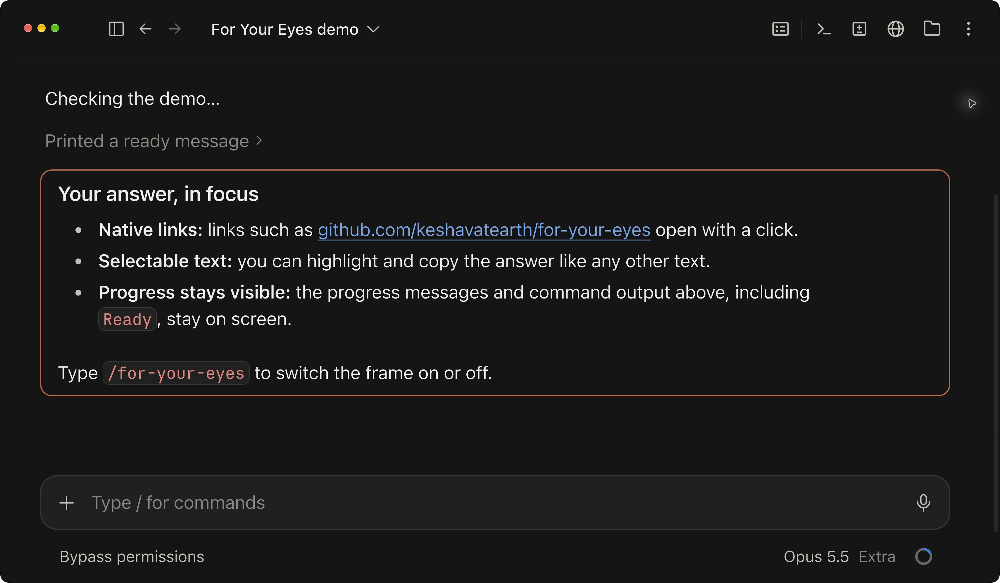

# For Your Eyes

**Put the final answer in focus.**

A Claude Code mod that frames each turn’s final answer, keeping links, selection, copy, and scrolling native to Claude.

Intermediate updates, thinking, and tool calls stay available. The mod only changes how final answers look; model output and saved conversations stay intact.



*For Your Eyes in Claude Code on macOS, using a sample conversation.*

## Install

Requires a Claude Code build with TypeScript mods support and Python 3 available as `python3`. Tested with Claude Code **2.1.300** and the Claude desktop app on macOS. This is a Claude **Code** mod, not a browser extension or a plugin for ordinary claude.ai chats.

```sh
claude plugin marketplace add keshavatearth/for-your-eyes
claude plugin install for-your-eyes@keshav-mods
```

Open a Code session in Claude Desktop or the terminal. The highlight is on by default. Run `/for-your-eyes` to turn it off or back on; the preference is saved locally.

Update an existing installation with:

```sh
claude plugin marketplace update keshav-mods
claude plugin update for-your-eyes@keshav-mods
```

Claude Desktop can reload an updated mod in an idle session. If your client does not, reopen the session. A terminal session needs to be restarted to load an installed update.

## Upgrading from Final Only

Version 0.4.0 renames the mod and command to `for-your-eyes`. Remove the old installation before installing the new name so only one copy is active:

```sh
claude plugin uninstall final-only@keshav-mods --keep-data
claude plugin marketplace update keshav-mods
claude plugin install for-your-eyes@keshav-mods
```

The renamed mod starts with highlighting on. If you previously kept it off, run `/for-your-eyes` once. Older GitHub links redirect to this repository.

## Appearance and interactions

- **Desktop:** final answers have a full rounded accent border. The interior stays transparent so Claude’s selection highlight remains visible.
- **Terminal:** final answers keep the rounded, accent-colored box and theme-aware background.
- **Other remote surfaces:** use the unfilled outline too; VS Code and mobile have automated render-contract coverage but have not been checked manually.

The border wraps exactly one native response. The mod does not turn answers into quotes, duplicate their text, replace native controls, add click handlers, or constrain their height/scrolling. Saved responses remain intact; selection and copy use Claude’s native controls.

On Desktop, v0.4.3 also normalizes local file-link destinations written in angle brackets: `[file](</path/with spaces.md>)` is drawn as `[file](/path/with%20spaces.md)`. The app otherwise treats that angle-bracket form as a missing file. This applies only to active final-answer rendering; saved messages, web links, images, and code examples remain intact. Relative file targets resolve from the session’s working folder, so a link still needs the correct path.

Version 0.3.3 removes the desktop background layer that interfered with visible selection, avoids unnecessary delayed redraws of settled answers, and hardens message identification. See the [mods render API](https://code.claude.com/docs/en/plugins/mods/interface) for the wrapper contract.

## How it works

The mod tracks main-conversation text rows and marks the last one when the turn ends. It reads the current session’s local JSONL transcript to identify answers in resumed conversations and to match Desktop’s message/block IDs to transcript rows. A temporary text match covers the delay before the transcript is written; repeated text is treated as ambiguous instead of guessing.

The transcript helper accepts compact and spaced JSON, handles multiple text blocks, and skips partial writes and subagent rows. If a message cannot be identified, it stays in Claude’s normal rendering.

The mod makes no network requests or model calls. It reads the current transcript and runs the bundled Python helper locally. It stores the on/off setting and bounded local load diagnostics (version, timestamp, turn count, and transcript path) in Claude’s plugin store. No chat data or diagnostics are included in this repository.

## Development

```sh
git clone https://github.com/keshavatearth/for-your-eyes.git
cd for-your-eyes
./scripts/check.sh
```

To try a local checkout, start `claude --plugin-dir .`. Avoid loading a second copy alongside an installed copy of the same mod. Claude writes its engine-specific TypeScript declarations into `.claude-plugin/types/` when it loads a development mod. These generated declarations are gitignored. After they exist, `tsc --project tsconfig.json` checks the source with TypeScript 5.4 or newer.

The mod tests exercise the engine’s real hook chain and returned render tree, including the native-engine response contract, live and resumed messages, summaries, ambiguous text, and the toggle. They do not emulate the desktop browser. For a release, also check a real desktop answer: select across paragraphs, copy the selection, open a web link and local file link, copy a code block, and scroll a long answer with the highlight on and off.

Mods are an evolving Claude Code API. See [Anthropic’s mods reference](https://code.claude.com/docs/en/plugins/mods/reference). If an update changes the rendering contract, `/for-your-eyes` restores ordinary rendering immediately.

## License

MIT. An independent project by Keshav, not affiliated with Anthropic.
